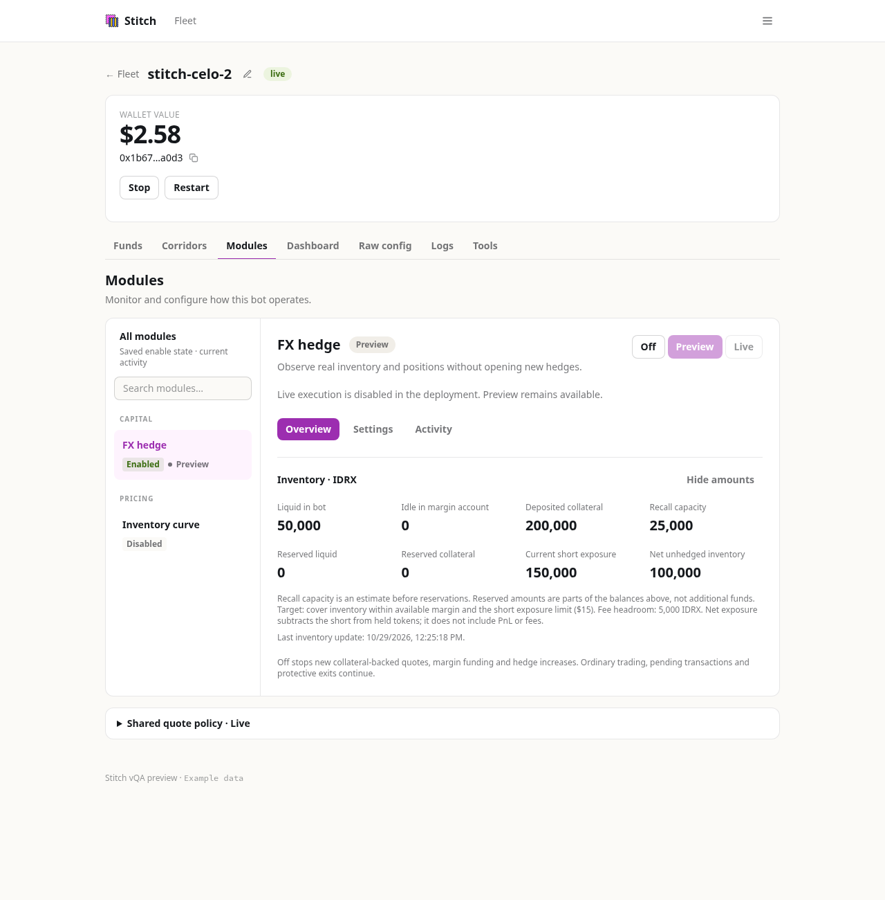
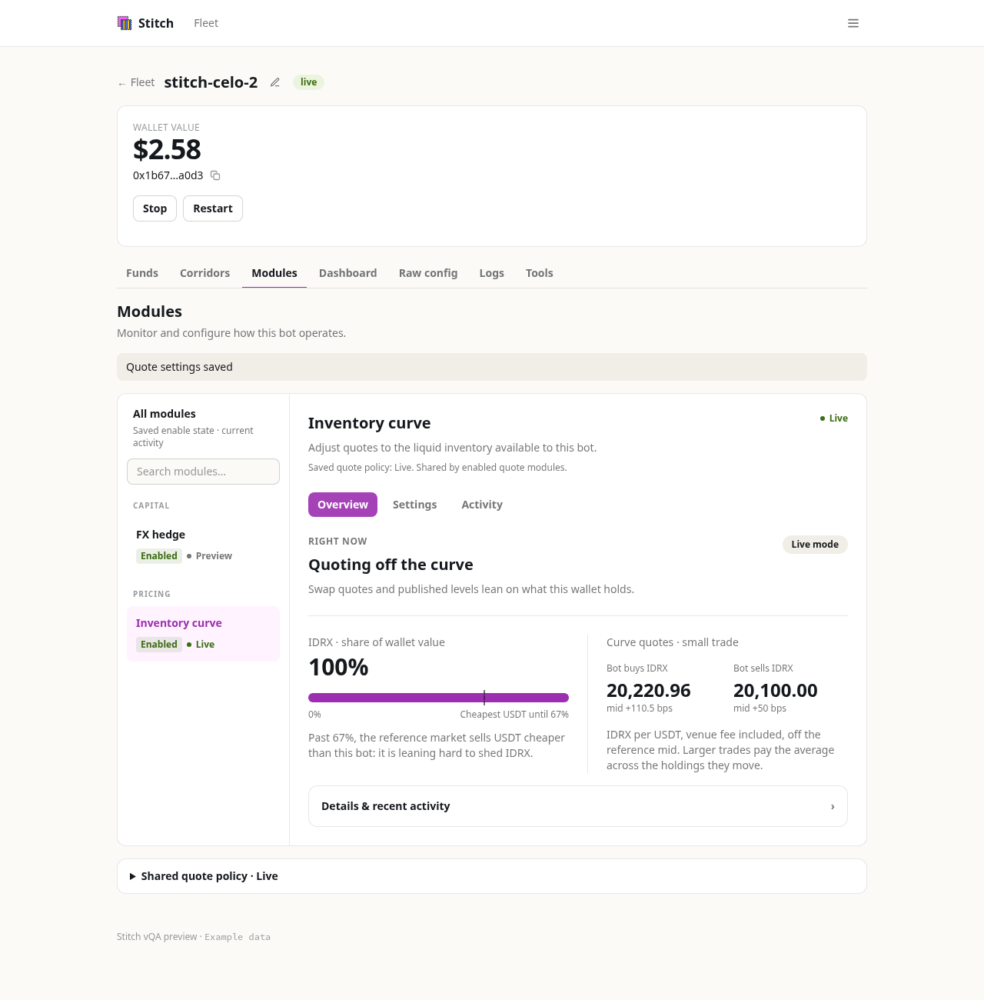
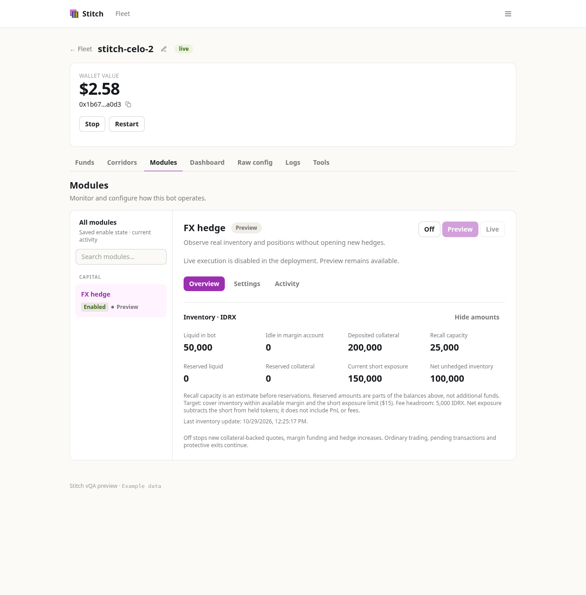
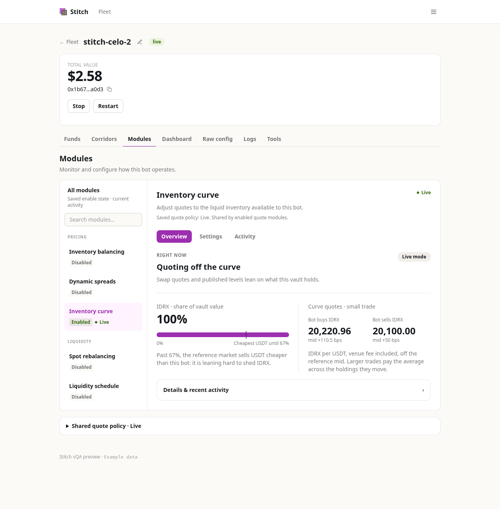
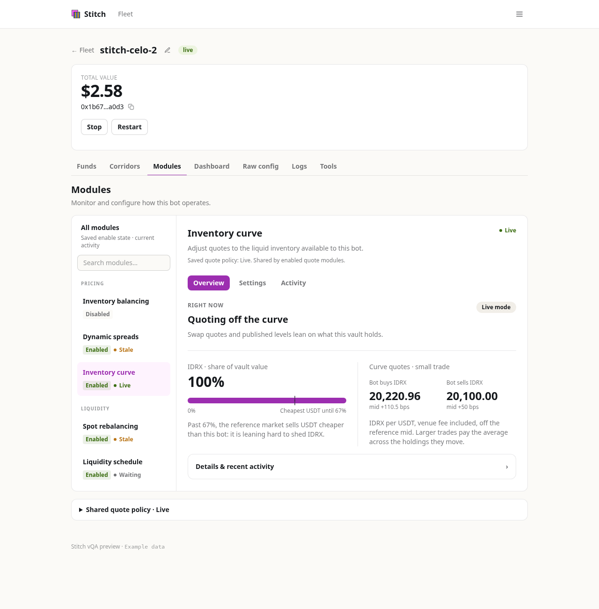

# FX hedge in Fleet

Open a bot’s **Corridors → Experimental** and turn on **Enable FX hedging**.
Existing assignments start in Preview. For a bot without an assignment, the
module opens for setup: open **Settings → Hedge configuration**, enter the assignment
supplied by Textile ops, then select **Preview**. Assignments still have to
match the bot, wallet and corridor on the server.

The module appears on **Funds**, **Dashboard** and **Modules**. It does not
require the separate inventory/quote-spread modules to be enabled. Experimental
and the module use the same saved hedge state.

| Mode    | Behavior                                                                                                                                                                                 |
| ------- | ---------------------------------------------------------------------------------------------------------------------------------------------------------------------------------------- |
| Preview | Observes real balances and positions without opening new hedges.                                                                                                                         |
| Live    | Allows execution within the assigned permissions and limits. Requires the deployment to permit execution, current inventory, configured limits and collateral-backed quoting permission. |
| Off     | Stops new recall commitments, margin funding and hedge increases. Ordinary trading continues. Existing obligations, transaction reconciliation and protective exits remain active.       |

The module stays visible after Off while margin funds, positions, reservations
or pending operations remain. Missing or stale data also keeps it visible. It
can disappear once a current snapshot confirms an empty hedge and no work is
pending. The Experimental link always lets you reopen its configuration.

Amounts use the collateral token’s decimals. **Authorized margin allocation**
accepts whole-token amounts (for example `250000.00` IDRX), preserving the
existing atomic-unit configuration on the server. It does not grant wallet
approvals or raise deployment limits. Changing modes or saving hedge settings
uses the existing bot restart flow.

Recall capacity is the keeper’s per-quote estimate before reservations; it is
not a promise that another quote can be issued. Net unhedged inventory is the
bot’s liquid balance plus idle margin and deposited collateral, minus short
token exposure. It excludes PnL and fees. The target description shows the
policy and exposure cap, not a new calculation of the worker’s next trade.

Pending counts cover all unreleased quotes and incomplete inventory actions.
The history shows the five latest recalls and five latest inventory actions.
Recorded recall preparation spend is not a complete operating-cost statement:
it excludes AWS, trader gas and owner transactions. The panel’s balance-hiding
setting also masks the new amounts.

Deploy the API update for complete pending counts and the deployment execution
flag, then update the Stitch panel image. An older API response keeps the
module visible conservatively when it cannot prove an Off hedge is empty.
No contract deployment, Terraform change or database migration is needed for
this UI change. Deploying it does not enable live hedging.

## Running modules together

FX hedging and quote modules can run on the same bot. For example, the IDRX
inventory curve can be Live while the hedge is in Preview, or the hedge can
stay Live while the curve is Off. Their settings and permissions are separate:

| Group         | Saved configuration                            | Responsibility                                                                    |
| ------------- | ---------------------------------------------- | --------------------------------------------------------------------------------- |
| FX hedge      | `[perps]` and the assigned Fleet authorization | Margin allocation, hedge exposure and collateral-backed settlement.               |
| Quote modules | `modules_enabled` and `[modules]`              | The inventory curve and supported vault inventory, spread and liquidity policies. |

The existing `modules_enabled` setting is not a master switch for hedging.
Turning it off removes the quote controls; the Modules tab stays available
when the hedge has an assignment or needs monitoring. Turning the hedge off leaves curve settings intact.
Each group keeps its own Preview/Live choice. Quote modules retain their
existing shared policy mode and individual enable switches.

The curve is currency-agnostic and uses the configured token decimals and
reference book. For IDRX these are 2 collateral decimals and 6 USDT decimals.
Its offsets must be chosen in IDRX per USDT, rather than copied from cNGN.
Current curve holdings are the liquid wallet balances (or the existing free
vault balances). GMX collateral is not added to that liquid balance. Recall
quotes keep their separate capacity, reservations and existing price path;
this UI change does not apply the curve to recall quotes or change hedge marks.

On **Modules**, each capability is a peer in one workspace. The always-visible list
uses Capital, Pricing and Liquidity categories and includes disabled modules,
even for a bot with just one module. Mobile shows the same list above the editor.
Selecting a module does not enable it. Enabled/Disabled badges show the saved
configuration separately from current activity. **Overview** shows readings,
**Settings** holds the controls and **Activity** shows history. Drafts survive
module navigation; the selected module and section survive refresh in the URL.
Refreshing still reloads saved settings, not unsaved drafts.

Quote modules retain a **Shared quote policy** mode, with every affected module
named before saving. This group-wide control sits below the workspace and has
its own Save button. Each module saves only its own settings; sibling drafts
remain unsaved, and module toggles never change the shared mode. Hedge settings
have a separate draft and write path. An assigned hedge stays in navigation
when disabled, while its empty dashboard summary can still disappear. Errors in one service leave
the other controls accessible. Search and navigation never save configuration.

`moduleWorkspace.ts` lists visibility, eligibility and navigation metadata;
`BotModules` chooses the page surface and `ModuleWorkspace` renders the focused
editor. Add future capabilities through that metadata and their own controller,
without changing another module’s authorization. Visibility must never
authorize execution, and unknown inventory must not hide cleanup.

Configuration writers use the existing per-bot lock and edit their own tables.
Quote-policy saves also check the full configuration revision, so an editor
opened before a hedge change cannot overwrite it. Future modules that trade or
move funds must use the existing reservation and execution paths; a UI card
does not give them independent spending authority. Existing incompatibility
checks remain, including the ban on combining two inventory leans (the curve
and vault inventory balancing).

## Screenshots

These are the implemented panel rendered with example API data, not production
balances. No setting or transaction was sent to a real bot for these captures.

FX hedge and the IDRX curve as peers, with the hedge selected:

Selecting the curve uses the same detail pane:

A single module keeps its sidebar:

[Mobile module list](images/modules-mobile.png) ·
[Mobile simulation](images/modules-mobile-simulate.png) ·
[Dark mobile settings](images/modules-dark-mobile.png) ·
[Off with pending obligations](images/fx-hedge-off.png) ·
[Experimental enable switch](images/fx-hedge-experimental.png).

One enabled vault module with all its disabled siblings visible:

A vault bot with four quote modules configured. This shows existing vault
policies; it does not imply that this vault can also enable FX hedge. Inventory
balancing remains off because it conflicts with the curve.

